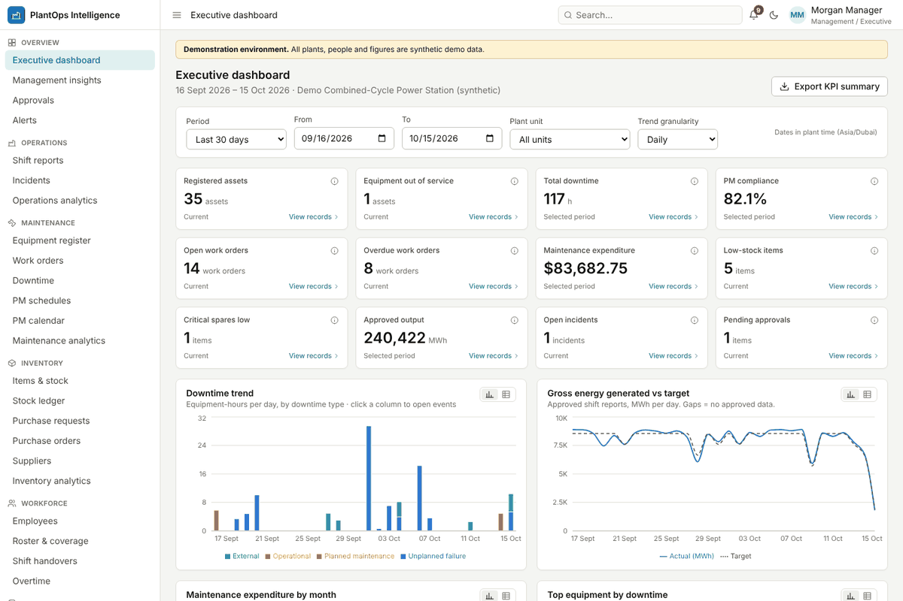
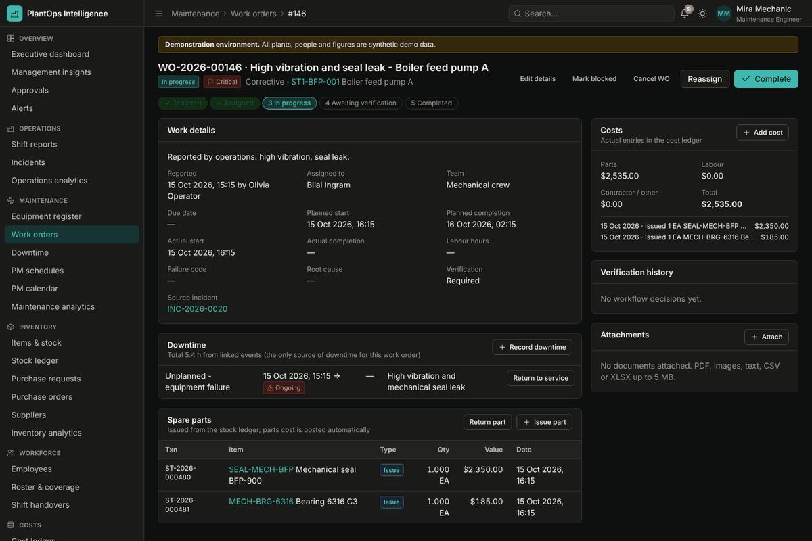
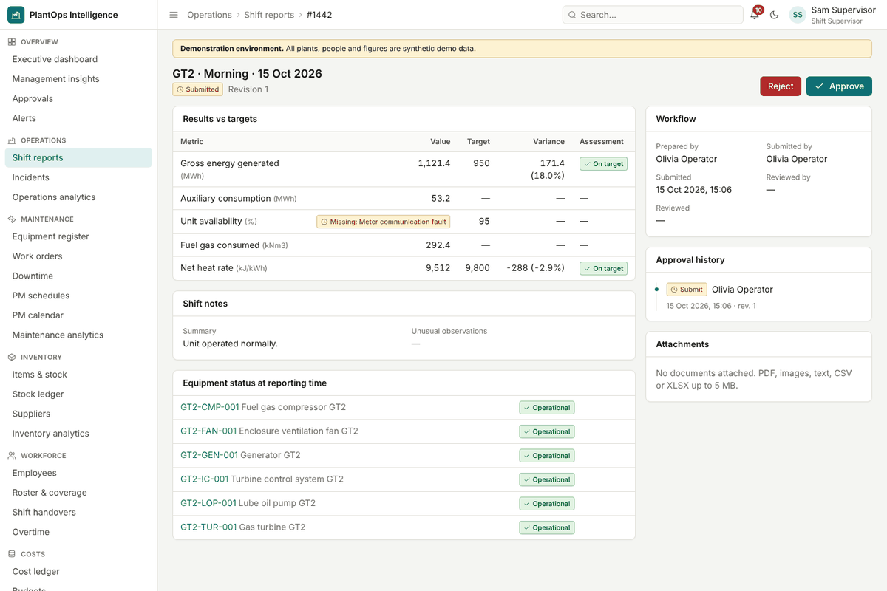
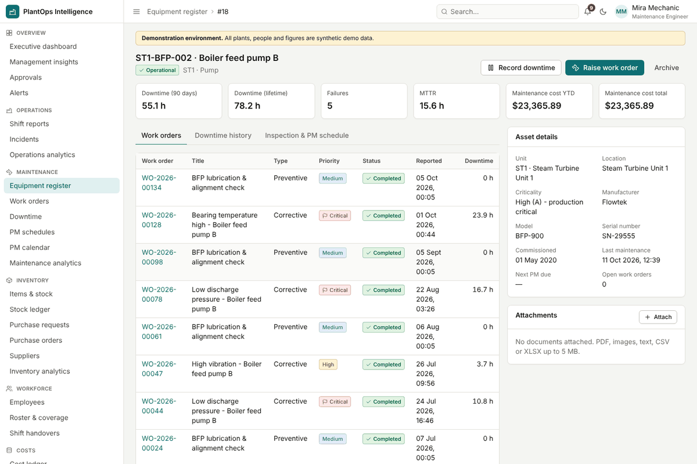
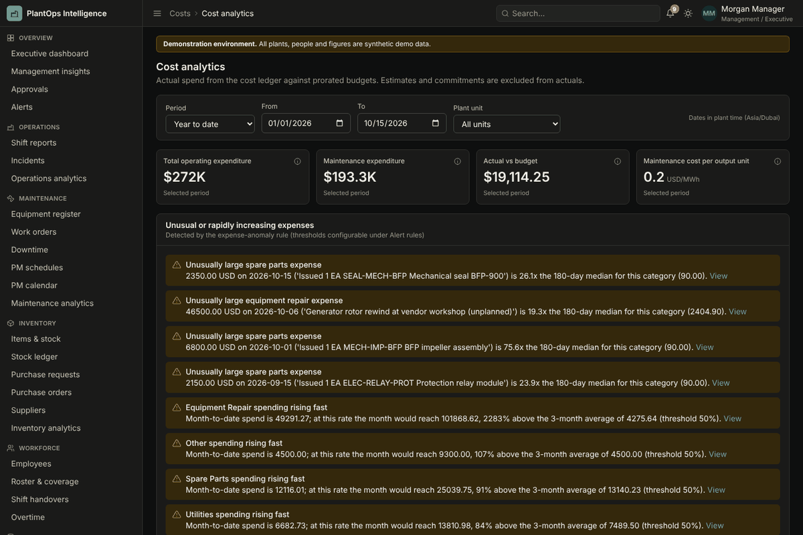
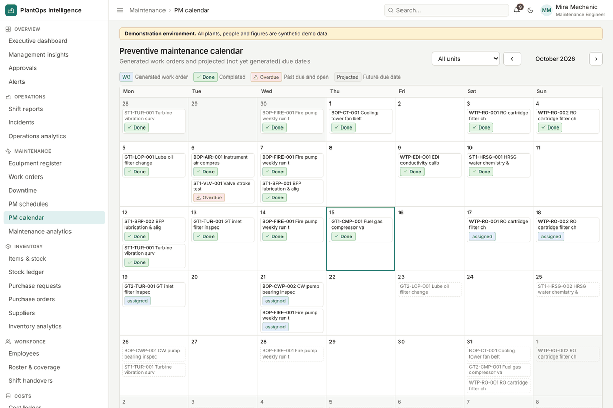
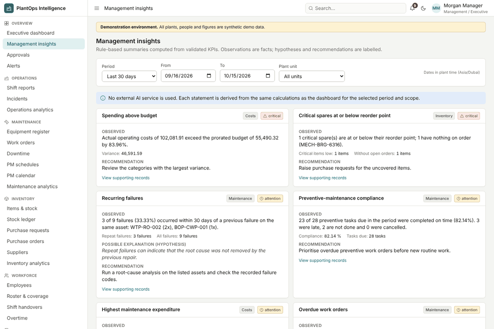
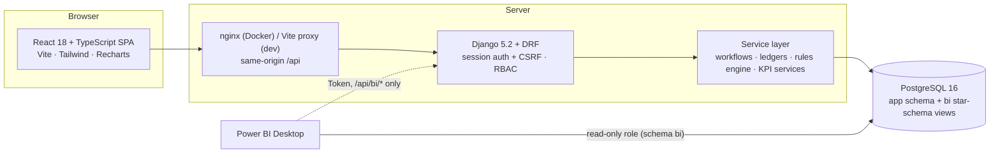

# PlantOps Intelligence

**Power plant management information system (MIS) and business intelligence platform.**

PlantOps Intelligence records daily plant operations (shift reports, incidents, equipment, maintenance,
spare parts, procurement, staffing, costs) in one PostgreSQL database. It turns those records into
reliable management information: KPIs, trends, exceptions, alerts, reports and a Power BI-ready star schema.



> The repository ships with a **synthetic demonstration dataset** (a fictional combined-cycle power station).
> All people, plants, suppliers and figures are invented.

## The business problem

Plant data is typically scattered across shift logbooks, spreadsheets, a maintenance tool and the store's
stock cards. Managers then cannot answer simple questions with confidence:

* How efficiently is the plant operating, and which equipment causes the most downtime?
* Which machines fail repeatedly, and what drives maintenance spend?
* Which preventive tasks are overdue, which critical spares are running out, which work orders are stuck?
* How do costs and output change over time, and what needs attention **today**?

PlantOps Intelligence answers these from validated transactional records, with every KPI defined once
([KPI dictionary](docs/KPI_DICTIONARY.md)) and reconciled between the application and the BI layer.

## Features

| Module | What it does |
|---|---|
| **Executive dashboard** | 12 KPI tiles (each with definition, formula, period type and a drill-through link) and 10 interactive charts with tooltips, table views and click-through to filtered records. Period presets, unit filter, data-freshness panel. |
| **Daily operations** | Configurable metrics per facility type (e.g. MWh, availability, heat rate, water production); shift reports with **Draft → Submitted → Approved/Rejected → Corrected** workflow; duplicate prevention per unit/shift/date; validation against plausible ranges; missing values require a reason (never zero); targets and variance; equipment status snapshot; incidents; missing-report detection; audited reopen of approved reports. |
| **Equipment register** | Asset register with category, unit, criticality, status, PM schedule, maintenance history, downtime, costs, documents; archive (never delete). |
| **Maintenance** | Work orders **Reported → Assigned → In progress → Awaiting verification → Completed** (+ cancel with reason; *overdue* and *blocked* as indicators). Downtime events are the single source of downtime (overlaps rejected by a PostgreSQL exclusion constraint). PM schedules on fixed calendar intervals with idempotent generation, calendar view, inspections. MTTR, MTBF, repeat failures, PM compliance, completion rate, average repair cost. |
| **Inventory & procurement** | Transactional stock ledger (receipts, issues, returns, adjustments) with row locks, idempotency keys, no negative stock, weighted-average cost. **PR → approval → PO → partial/full receipt → closed**, with duplicate-receipt protection. Valuation, turnover, slow movers, supplier lead time, consumption. |
| **Workforce** | Employees (contact data role-restricted), shift definitions, roster, coverage (covered / understaffed / unassigned), handovers with acknowledgement, overtime with approval and automatic costing. |
| **Costs** | One cost ledger (manual, work-order, stock-issue and overtime entries; actual vs estimate vs commitment), monthly budgets prorated to any period, actual vs budget, cost by asset / category / department / unit, cost per MWh, anomaly detection. |
| **Alerts** | Rules engine with 10 configurable rules (excessive downtime, overdue / upcoming PM, overdue work orders, critical / low stock, pending approvals, missing shift reports, metric thresholds, expense anomalies). Each alert explains why it fired and links to the record; deduplicated per condition; acknowledge / resolve / dismiss; auto-resolve when the condition clears; history. |
| **Reports & exports** | 14 reports (daily operations, shift handover, staffing coverage, overtime, asset status, maintenance history, downtime analysis, PM compliance, work-order performance, stock movements, inventory status, procurement, costs, executive KPI summary) with filters, pagination, streamed CSV and XLSX (with a metadata sheet). |
| **Power BI** | 20 read-only star-schema views in schema `bi`, a read-only database role, a token-protected read-only API, documented relationships and DAX, and `manage.py bi_reconcile` proving that the SQL behind each measure equals the application KPI. See the [Power BI guide](docs/powerbi/README.md). |
| **Insights** | Rule-based management insights that separate *observations* (facts with evidence) from *hypotheses* and *recommendations*. No external AI service is called. |
| **Platform** | Six roles with server-side permissions ([matrix](docs/PERMISSIONS.md)), object-level rules, audit log, notifications, global search, light/dark themes, responsive layout. |

| | |
|---|---|
|  |  |
|  |  |
|  |  |

More screenshots: [docs/screenshots](docs/screenshots).

## Architecture



* **Backend** (`backend/`): Django apps per domain (`accounts`, `core`, `assets`, `operations`, `maintenance`,
  `inventory`, `workforce`, `costs`, `alerts`, `analytics`, `bi`). Business rules live in each app's
  `services.py` and run inside database transactions; viewsets are thin. Details: [docs/ARCHITECTURE.md](docs/ARCHITECTURE.md).
* **Frontend** (`frontend/`): typed API client, auth/theme/reference contexts, a schema-driven CRUD toolkit,
  chart components following a validated colour-blind-safe palette, and pages per module.
* **Data model**: [docs/ERD.md](docs/ERD.md). **Business rules and edge cases**: [docs/DATA_RULES.md](docs/DATA_RULES.md).
* **API reference**: [docs/API.md](docs/API.md). **Security**: [docs/SECURITY.md](docs/SECURITY.md).

### Technology (versions tested)

| Layer | Versions |
|---|---|
| Backend | Python 3.13 (3.12 in Docker), Django 5.2.18 LTS, Django REST Framework 3.16.1, django-filter 26.2, psycopg 3.2.13, openpyxl 3.1.5, python-dotenv 1.2.4, gunicorn 23.0.0 |
| Database | PostgreSQL 16 (uses the `btree_gist` extension, a trusted extension the database owner can create) |
| Frontend | Node 22, React 18.3.1, TypeScript 5.7.2, Vite 5.4.21, Tailwind CSS 3.4.17, Recharts 3.10.0, Axios 1.7.9, React Router 6.30.1 |
| Tests | pytest 9 + pytest-django 4.14, Vitest 2.1.9 + Testing Library, Playwright 1.56.1 |

Celery/Redis are not used: alert evaluation and PM generation are management commands for a scheduler,
plus throttled on-read evaluation.

## Getting started

### Windows (PowerShell)

1. Install **Python 3.12+**, **Node.js 22 LTS** and **PostgreSQL 16** (EDB installer; keep `psql` on PATH).
2. Create the database role and database (run once; choose your own password):
   ```powershell
   psql -U postgres -c "CREATE ROLE plantops LOGIN PASSWORD 'change-me-locally';"
   psql -U postgres -c "CREATE DATABASE plantops OWNER plantops;"
   ```
3. Backend:
   ```powershell
   git clone <this repository> plantops-intelligence; cd plantops-intelligence
   Copy-Item .env.example .env          # edit POSTGRES_PASSWORD (and DJANGO_SECRET_KEY outside dev)
   py -3.12 -m venv .venv; .\.venv\Scripts\Activate.ps1
   pip install -r backend\requirements-dev.txt
   cd backend
   python manage.py migrate
   python manage.py seed_demo           # synthetic demo data (~3 minutes); safe to re-run
   python manage.py runserver 127.0.0.1:8000
   ```
4. Frontend (second terminal):
   ```powershell
   cd frontend; npm ci; npm run dev
   ```
5. Open <http://localhost:5173>.

### Linux / macOS

```bash
cp .env.example .env                                   # set POSTGRES_PASSWORD
python3 -m venv .venv && . .venv/bin/activate
pip install -r backend/requirements-dev.txt
(cd backend && python manage.py migrate && python manage.py seed_demo && python manage.py runserver 127.0.0.1:8000) &
(cd frontend && npm ci && npm run dev)
```

### Docker

```bash
cp .env.example .env      # set DJANGO_SECRET_KEY, POSTGRES_PASSWORD; set DJANGO_DEBUG=false
docker compose up --build -d
docker compose exec backend python manage.py seed_demo
# http://localhost:8080   (PostgreSQL for Power BI on 127.0.0.1:5433)
```
`docker-compose.yml`, the Dockerfiles and `frontend/nginx.conf` are included but were **not run in the build
environment** (no Docker daemon was available); the native setup above is the tested path.

### Demo accounts

| Username | Role | Typical use |
|---|---|---|
| `admin` | Administrator | users, reference data, thresholds, audit log |
| `operations`, `operations2` | Operations Officer | shift reports, incidents, fault reports |
| `maintenance`, `maintenance2` | Maintenance Engineer | assets, work orders, PM, downtime |
| `store` | Store & Procurement Officer | stock ledger, purchase orders, receipts |
| `supervisor`, `supervisor2` | Shift Supervisor | report approval, verification, roster, overtime |
| `manager` | Management / Executive | dashboards, insights, purchase approval, Power BI |

Password: the value of `PLANTOPS_DEMO_PASSWORD` (default `PlantOps-Demo-2026`). **Demo only** - the seeder refuses
to run against a database that already contains non-demo data.

### Seed data

```bash
python manage.py seed_demo                      # refuses if demo data already exists (no duplicates)
python manage.py seed_demo --reset              # wipe and rebuild (only when PLANTOPS_DEMO_MODE=true)
python manage.py seed_demo --days 120 --seed 42 # history length and random seed (reproducible)
```
The seeder replays 120 days through the **same service layer as the API** (work-order lifecycle, stock ledger,
procurement, approvals, alert evaluation), so ledgers, KPIs and audit history reconcile. It ends with a live
breakdown in progress, a critical spare consumed, pending approvals and in-transit purchase orders.

### Scheduled jobs

Schedule these with cron or Windows Task Scheduler (every 5-15 minutes and daily, respectively):
```bash
python manage.py evaluate_alerts
python manage.py generate_pm_work_orders
```
Alert evaluation also runs automatically (at most every 5 minutes) when the alert centre is opened.

## Tests

| Suite | Command | Result in the build environment |
|---|---|---|
| Backend (pytest, real PostgreSQL) | `cd backend && pytest` | **76 passed** - permissions, workflows, ledger incl. a 12-thread concurrency test, procurement idempotency, alerts, KPI accuracy, BI reconciliation, exports |
| Lint | `cd backend && ruff check .` / `cd frontend && npm run typecheck` | clean |
| Frontend (Vitest + Testing Library) | `cd frontend && npm test` | **20 passed** - protected routes, permission-aware UI, theme persistence, forms, tables, filters, states |
| End-to-end (Playwright) | `cd e2e && npm ci && ./run-e2e.sh` (backend virtualenv active, or `PYTHON=/path/to/python`) | **4 passed** - full corrective-maintenance flow across 4 roles, CSV export verification, approval workflow, theme persistence, server-side RBAC |

`run-e2e.sh` provisions an isolated database (`plantops_e2e`), seeds 30 days, starts both servers and runs the
browser tests. Details: [docs/TESTING.md](docs/TESTING.md).

## Documentation

| Document | Contents |
|---|---|
| [docs/ARCHITECTURE.md](docs/ARCHITECTURE.md) | Components, request flow, service layer, design decisions |
| [docs/ERD.md](docs/ERD.md) | Entity-relationship diagram and constraints |
| [docs/DATA_RULES.md](docs/DATA_RULES.md) | Sources of truth, validation, overlapping faults, partial periods, missing data |
| [docs/KPI_DICTIONARY.md](docs/KPI_DICTIONARY.md) | Every KPI, alert rule, report and BI dataset (generated from code) |
| [docs/PERMISSIONS.md](docs/PERMISSIONS.md) | Role-permission matrix (generated from code) |
| [docs/API.md](docs/API.md) | REST API reference |
| [docs/SECURITY.md](docs/SECURITY.md) | Authentication, authorisation, audit, uploads, backup and restore |
| [docs/powerbi/README.md](docs/powerbi/README.md) | Power BI connection, star schema, relationships, DAX, layout, refresh, validation |
| [docs/TESTING.md](docs/TESTING.md) | Test strategy and how to run each suite |
| [docs/CASE_STUDY.md](docs/CASE_STUDY.md) | How the system supports management decisions |

Regenerate the derived documents after changing KPIs, rules, reports or roles: `python manage.py export_docs`.

## Known limitations

* **Single currency.** All money is stored in the configured base currency; there is no FX conversion.
* **One time zone per plant**; cross-plant analytics use the default plant's time zone for period boundaries.
* **MTBF approximation:** assets commissioned or archived mid-period count for the whole period; MTBF is
  flagged *low confidence* below three failures.
* **Inventory is plant-wide** (one store); stock is not tracked per bin or per unit, and there are no lot or
  serial numbers.
* **Budgets are monthly** and prorated by days; there are no budget versions or approval workflow.
* **Notifications are in-app only**; email delivery is not implemented.
* **Power BI**: the model, DAX and validation tooling are provided, but no `.pbix` file or published Power BI
  Service report is included (Power BI Desktop was not available in the build environment).
* **Docker** files are provided but were not executed in the build environment.
* Attachments are stored on the local filesystem (`MEDIA_ROOT`); use object storage for multi-server deployments.
* Insights are rule-based. There is no machine-learning, predictive-maintenance or LLM component (deliberately
  out of scope for this release).

## Future enhancements

Predictive maintenance from condition-monitoring data, an optional LLM summariser over the insight engine's
verified facts (with explicit configuration and data-sharing approval), email/Teams notifications, multi-currency,
mobile shift-report entry with offline support, and a published Power BI template app.

## Repository layout

```
backend/      Django project (apps/*, plantops/settings.py, requirements*.txt, Dockerfile)
frontend/     React SPA (src/pages, src/components, src/api, Dockerfile, nginx.conf)
e2e/          Playwright tests and the isolated e2e runner
docs/         Architecture, ERD, rules, KPI dictionary, API, security, Power BI, case study, screenshots
docker-compose.yml, .env.example
```
