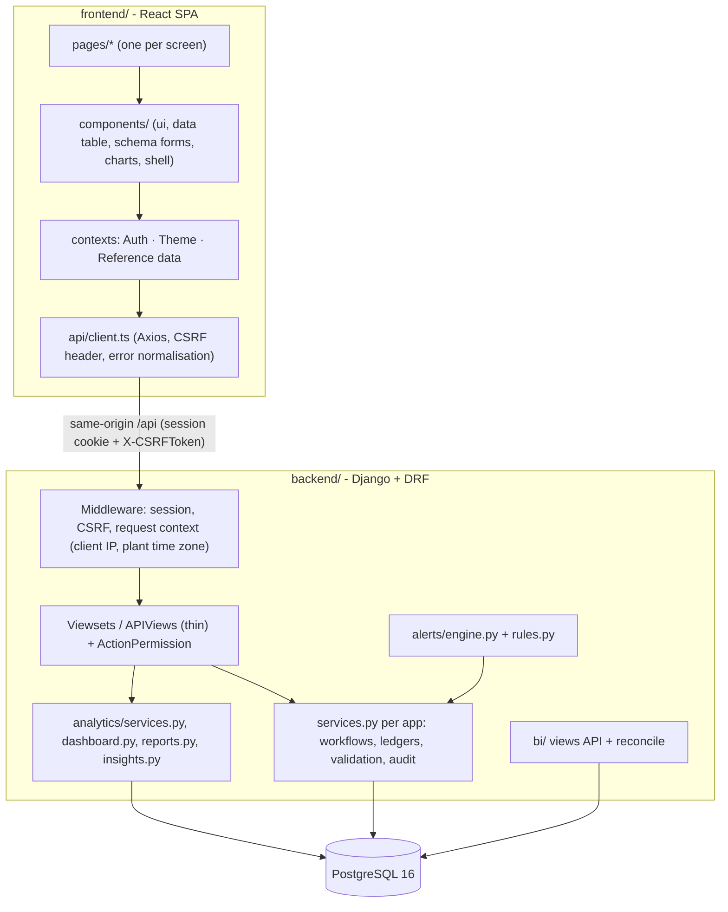

# Architecture

## Components

## Request flow

1. The SPA calls `/api/...` on its own origin (Vite proxy in development, nginx in Docker), so the Django
   session cookie and CSRF cookie are first-party. `api/client.ts` adds `X-CSRFToken` to every unsafe request.
2. `RequestContextMiddleware` records the client IP (for audit records) and activates the default plant's time
   zone, so `timezone.localdate()` and date filters use the plant's business date.
3. `ActionPermission` maps the viewset action to a named permission (`view.action_permissions`) and checks it
   against `accounts/roles.py`. Unmapped actions are denied. Object-level rules (e.g. a supervisor may review
   only reports of units assigned to them, nobody approves their own submission) are enforced in services.
4. Viewsets validate input shape with serializers and delegate to a **service function** that runs inside
   `transaction.atomic()`, takes row locks where needed (`SELECT ... FOR UPDATE`), enforces business rules,
   writes audit and approval records, and posts follow-on entries (e.g. stock issue → cost-ledger row).
5. Business-rule violations raise Django `ValidationError`; the custom exception handler turns them into the
   same `{detail, errors}` shape as serializer errors, which the frontend maps onto form fields.

## Apps and responsibilities

| App | Responsibility |
|---|---|
| `accounts` | Custom user with role and assigned units, role-permission matrix, permission classes, audit log, approval records, login/logout/me |
| `core` | Plants, units, departments, typed system settings, attachments (validated uploads), document numbering, reporting-period parsing, time helpers, simulation clock |
| `assets` | Equipment categories and register, archive action, asset summary |
| `operations` | Metric definitions, shift reports and measurements, equipment status snapshots, incidents, report workflow, missing-report detection |
| `maintenance` | PM schedules, work orders (lifecycle), downtime events (exclusion constraint), inspections, PM generation and calendar |
| `inventory` | Items, suppliers, stock ledger (`post_transaction`), purchase requests/orders, goods receipts |
| `workforce` | Employees, shifts, assignments and coverage, handovers, overtime approval and costing |
| `costs` | Cost ledger (`OperationalExpense`) and budgets |
| `alerts` | Rule definitions, evaluation engine (dedup / auto-resolve), alerts, activity, notifications |
| `analytics` | KPI dictionary, KPI calculations, dashboard and module analytics, insights, report registry, exports, global search |
| `bi` | SQL star-schema views (migrations), read-only dataset API, token management, reconciliation |

## Key design decisions

| Decision | Reason |
|---|---|
| **Session authentication + CSRF** for the SPA; **DRF tokens only for `/api/bi/`** | No tokens in browser storage; the BI token cannot be used against the transactional API. |
| **Roles as data on the user + a single permission matrix** | Auditable and testable in one file; the frontend receives the user's permission list only to hide controls. |
| **Service layer for every state change** | Business rules are reusable (API, seeder, commands) and testable without HTTP. |
| **One cost ledger** | Parts are costed at issue, labour/contractor/overtime post to the same table - costs cannot be double counted. Receipts are inventory, not expense. |
| **Downtime only from timestamped events**, overlap prevented by `EXCLUDE USING gist` | Downtime cannot be counted twice; durations are derived, never typed. |
| **Stock changes only through `post_transaction`** with row lock, idempotency key re-checked after the lock, `CHECK (current_stock >= 0)` | Correct under concurrent requests and retries (tested with 12 parallel threads). |
| **Metrics are configuration** (`MetricDefinition`) | Different facility types record different measurements; no hard-coded energy fields. |
| **Fixed-calendar PM schedules** with a unique `(schedule, due_date)` constraint | Idempotent generation; compliance is measured against the original plan. |
| **KPI definitions as data** (`analytics/kpis.py`) | The same text appears in API responses, the UI, generated docs and the Power BI guide. |
| **Rule evaluators + engine** | One place for thresholds and dedup logic instead of checks scattered through the code. |
| **Star-schema SQL views in a `bi` schema** | BI tools read curated, stable views; a role can be limited to that schema. |
| **No Celery/Redis** | Workloads are small; management commands + throttled on-read evaluation suffice (documented scheduling). |

## Frontend structure

* `src/api/` - Axios client (`withCredentials`, CSRF header, typed `ApiError` with field errors), shared types.
* `src/auth/` - session user, `can(permission)`, `<Can>` for permission-aware controls.
* `src/theme/` - theme provider (light / dark / system, persisted in `localStorage` and on the user profile),
  chart palette tokens. `index.html` applies the stored theme before first paint.
* `src/lib/` - formatting in the plant time zone, reference data (plants, units, departments, settings).
* `src/components/` - UI primitives, `DataTable`, `Pagination`, schema-driven `ResourceFormDialog`,
  `ResourcePage` (list + filters + create/edit), chart wrappers (`ChartCard` with table view, `KpiCard`), app shell.
* `src/pages/` - one folder per module. Filters live in the URL (`useUrlState`), so dashboard drill-through links
  open pre-filtered lists and filtered views are shareable.

## Theming

Semantic tokens (`--page`, `--surface`, `--ink`, `--accent`, `--good`, `--warn`, `--bad`, ...) are defined in
`src/index.css` for `:root` and `[data-theme="dark"]` and exposed to Tailwind as colours. Charts use a
categorical palette validated for colour-vision deficiency in both themes; because three light-mode slots are
below 3:1 contrast, every chart has a legend and a table view. Status is never conveyed by colour alone (badges
carry an icon and a label).
