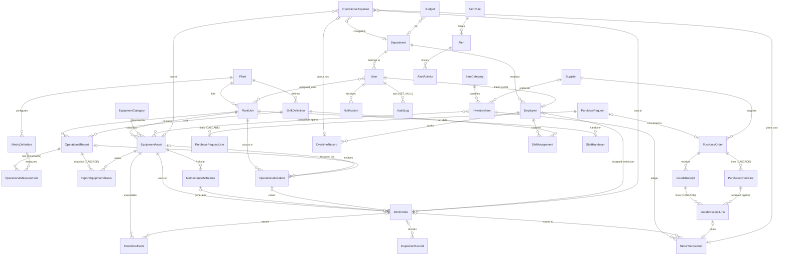

# Entity-relationship diagram

Main entities and relationships (Django model names). All foreign keys use `PROTECT` unless noted, so history
cannot be orphaned by deleting reference data; records are deactivated or archived instead.

Generic relations: `ApprovalRecord` (workflow history) and `Attachment` (files) point to any record through
`(content_type, object_id)`. `NumberSequence` issues human-readable numbers (`WO-2026-00042`) under a row lock.

## Integrity constraints enforced by the database

| Table | Constraint |
|---|---|
| `OperationalReport` | `UNIQUE (plant_unit, shift, report_date)` - no duplicate shift reports |
| `OperationalMeasurement` | `UNIQUE (report, metric)`; `CHECK (value IS NOT NULL OR missing_reason <> '')` - missing data needs a reason |
| `MetricDefinition` | `UNIQUE (plant, code)`; one active primary-output metric per plant (partial unique index); `valid_min <= valid_max` |
| `WorkOrder` | `UNIQUE (schedule, due_date) WHERE schedule IS NOT NULL` - no duplicate PM work orders; planned/actual windows ordered; cancelled ⇒ reason; labour hours ≥ 0 |
| `DowntimeEvent` | `CHECK (ended_at > started_at)`; `EXCLUDE USING gist (asset WITH =, tstzrange(started_at, ended_at) WITH &&)` - no overlapping downtime per asset (open events are unbounded ranges) |
| `InventoryItem` | `CHECK (current_stock >= 0)`, non-negative levels and cost |
| `StockTransaction` | quantity ≠ 0; sign matches type; `balance_after >= 0`; `UNIQUE idempotency_key` |
| `PurchaseOrderLine` | `0 <= quantity_received <= quantity_ordered`; one line per item |
| `GoodsReceipt` | `UNIQUE idempotency_key` - a resubmitted delivery is detected |
| `OperationalExpense` | amount ≠ 0; negative amounts only for system stock-return credits; `UNIQUE stock_transaction`, `UNIQUE overtime` |
| `Budget` | `UNIQUE (year, month, department, category) NULLS NOT DISTINCT`; month 1-12; amount ≥ 0 |
| `ShiftAssignment` | `UNIQUE (employee, date)` |
| `ShiftHandover` | `UNIQUE (plant_unit, shift, date)` |
| `Alert` | `UNIQUE (rule, dedup_key) WHERE condition_cleared_at IS NULL` - one live alert per condition |

Money uses `DecimalField` everywhere (2 dp for amounts, 4 dp for unit costs); quantities use 3 dp decimals.
Timestamps are `timestamptz` stored in UTC; business dates are `date` in the plant's local time.
