# Power BI integration guide

Power BI is a separate BI layer on top of PlantOps Intelligence. The web application's dashboards work
without it; Power BI adds self-service analysis over the same, reconciled figures.

> **Status, stated plainly:** the database views, read-only role, API, DAX definitions and the
> reconciliation command below are implemented and tested. No `.pbix` file or Power BI Service
> report has been built or published from this repository (Power BI Desktop is Windows-only and was not
> available in the build environment). Follow this guide to build the report; the measures are designed
> to reproduce the application's KPIs exactly, and `bi_reconcile` proves that the underlying SQL does.

## 1. Data architecture

The `bi` schema (migrations `apps/bi/migrations/0001` and `0002`, SQL in `backend/apps/bi/sql/`) exposes a
star schema of read-only views. Facts carry integer date keys (`YYYYMMDD`) in the **plant's local time
zone**, matching the application's reporting periods.

```mermaid
erDiagram
    DimDate ||--o{ FactDowntimeDaily : date_key
    DimDate ||--o{ FactDowntimeEvents : "end_date_key (active) / start_date_key"
    DimDate ||--o{ FactWorkOrders : "reported_date_key (active) / due_date_key / completed_date_key"
    DimDate ||--o{ FactOperationalCosts : date_key
    DimDate ||--o{ FactBudgetDaily : date_key
    DimDate ||--o{ FactOperationalMeasurements : date_key
    DimDate ||--o{ FactInventoryTransactions : date_key
    DimDate ||--o{ FactPurchaseReceipts : date_key
    DimPlantUnit ||--o{ FactDowntimeDaily : unit_id
    DimPlantUnit ||--o{ FactWorkOrders : unit_id
    DimPlantUnit ||--o{ FactOperationalCosts : unit_id
    DimPlantUnit ||--o{ FactOperationalMeasurements : unit_id
    DimAsset ||--o{ FactDowntimeDaily : asset_id
    DimAsset ||--o{ FactDowntimeEvents : asset_id
    DimAsset ||--o{ FactWorkOrders : asset_id
    DimAsset ||--o{ FactOperationalCosts : asset_id
    DimDepartment ||--o{ FactOperationalCosts : department_id
    DimDepartment ||--o{ FactBudgetDaily : department_id
    DimCostCategory ||--o{ FactOperationalCosts : category
    DimCostCategory ||--o{ FactBudgetDaily : category
    DimMaintenanceType ||--o{ FactWorkOrders : maintenance_type
    DimEmployee ||--o{ FactWorkOrders : employee_id
    DimMetric ||--o{ FactOperationalMeasurements : metric_id
    DimShift ||--o{ FactOperationalMeasurements : shift_id
    DimInventoryItem ||--o{ FactInventoryTransactions : item_id
    DimInventoryItem ||--o{ FactPurchaseReceipts : item_id
    DimSupplier ||--o{ FactPurchaseReceipts : supplier_id
```



| View | Grain | Notes |
|---|---|---|
| `bi.dim_date` | one calendar day 2020-2032 | Mark as date table on `date`. Includes `fiscal_year` from the fiscal-year setting. |
| `bi.dim_plant_unit` | unit | `-1` = "Plant-wide (no unit)" so plant-level costs are not lost under a unit slicer. |
| `bi.dim_asset` | asset | `-1` = "No asset". Carries `unit_code` as an attribute (see relationships). |
| `bi.dim_department`, `bi.dim_cost_category`, `bi.dim_maintenance_type`, `bi.dim_metric`, `bi.dim_shift`, `bi.dim_supplier` | reference | Small dimensions. |
| `bi.dim_employee` | employee | **No contact details or pay rates.** |
| `bi.dim_inventory_item` | item | Current stock, weighted-average cost, `stock_status` (snapshot). |
| `bi.fact_downtime_daily` | downtime event x local day | **Use for downtime totals.** Events crossing midnight/period edges are split exactly like the app. |
| `bi.fact_downtime_events` | downtime event | Whole events; for MTTR and failure counts. |
| `bi.fact_work_orders` | work order | Timing, `is_open`, `is_overdue`, `pm_counted`, `pm_on_time`. `wo_total_cost` is an attribute only. |
| `bi.fact_operational_costs` | cost-ledger row | Filter `cost_type = "ACTUAL"` for spend. `is_maintenance` = linked to asset/work order. |
| `bi.fact_budget_daily` | budget line x day | Monthly budgets / days in month - prorates any date range. |
| `bi.fact_operational_measurements` | measurement on an **approved** report | `value` NULL = not recorded (never zero); `target_value` only where a value exists. |
| `bi.fact_inventory_transactions` | stock movement | Signed quantity/value; `consumption_value` = issues minus returns. |
| `bi.fact_purchase_receipts` | goods-receipt line | Received value at order price. |
| `bi.fact_alerts` | alert | Status, severity, age. |

### Avoiding double counting

* Costs come only from `FactOperationalCosts` (the single cost ledger). Parts are costed when issued, so
  goods receipts (`FactPurchaseReceipts`) are inventory acquisition, **not** maintenance expense. Never add
  `FactWorkOrders[wo_total_cost]` to ledger totals.
* Downtime comes only from downtime events. A work order's downtime is the sum of its linked events;
  overlapping events on one asset are impossible (database exclusion constraint).
* Facts are never related to other facts. There is no `DimAsset -> DimPlantUnit` relationship: both
  dimensions filter the facts directly, so there is exactly one filter path from a unit to a fact.

## 2. Connecting Power BI Desktop

### Option A - PostgreSQL (recommended)

1. A DBA creates the read-only role (password supplied at run time, never committed):
   ```bash
   psql -d plantops -v bi_password="'<strong password>'" -f docs/powerbi/create_bi_reader.sql
   ```
   The role can only `SELECT` from schema `bi`; its sessions are read-only with a statement timeout.
   It has no access to application tables (users, audit log, contact data) - verified locally: reading
   `accounts_user` fails with *permission denied* and `CREATE TABLE` fails with *read-only transaction*.
2. Power BI Desktop → **Get data → PostgreSQL database** → server `host:5432`, database `plantops`,
   **Import** mode. Credentials: *Database*, user `plantops_bi_reader`. Use TLS (`sslmode=require`) on any
   non-local network. Power BI Desktop includes the Npgsql provider; older versions need it installed.
3. In the navigator, select the `bi.*` views listed above and **Transform data**.

### Option B - REST API (Web connector)

For environments without direct database access. Users with `bi.access` (Administrator, Management) issue a
personal token on **Reports & BI → Power BI access**. Tokens are accepted only by `/api/bi/` endpoints.

```powerquery
let
    Base = "https://plantops.example.com/api/bi/datasets/",
    Token = "Token " & #"BI token parameter",
    Page = (name as text, offset as number) =>
        Json.Document(Web.Contents(Base, [RelativePath = name & "/", Query = [limit = "50000", offset = Text.From(offset)],
                                          Headers = [Authorization = Token]])),
    Load = (name as text) =>
        let first = Page(name, 0),
            pages = List.Generate(() => [o = 0, p = first], each List.Count([p][rows]) > 0,
                                  each [o = [o] + 50000, p = Page(name, [o] + 50000)], each [p][rows]),
            rows = List.Combine(pages)
        in Table.FromRecords(rows),
    FactDowntimeDaily = Load("fact_downtime_daily")
in
    FactDowntimeDaily
```
Store the token in a Power BI **parameter** and use `RelativePath` (as above) so scheduled refresh in the
Power BI Service can validate the data source.

### Option C - files

Report center → any report → **CSV/XLSX**. XLSX files include a *Report info* sheet with the period, time
zone and generation time. Suitable for one-off analysis, not for a refreshed model.

## 3. Power Query transformations

1. Rename queries to friendly names: `bi.fact_downtime_daily` → `FactDowntimeDaily`, `bi.dim_date` → `DimDate`, etc.
2. Set data types: `date_key` columns → *Whole number*; `date` → *Date*; timestamps → *Date/Time/Timezone*;
   `amount`, `budget_amount`, `unit_cost`, `received_value` → *Fixed decimal number* (currency);
   hours and quantities → *Decimal number*; flags (`is_open`, `pm_on_time`, ...) → *True/False*.
3. Keep `NULL` measurement values as null. **Do not replace nulls with 0** - a missing reading is not zero.
4. Disable load for any helper query; do not merge facts together.
5. `DimDate`: *Mark as date table* using `date`. Sort `month_short` by `month` and `year_month` by `month_start`.

## 4. Relationships

| From (many) | To (one) | Active | Purpose |
|---|---|---|---|
| every fact `date_key` | `DimDate[date_key]` | yes | Period filtering |
| `FactWorkOrders[reported_date_key]` | `DimDate[date_key]` | **yes** | Work orders reported in period |
| `FactWorkOrders[due_date_key]` | `DimDate[date_key]` | no | PM compliance (`USERELATIONSHIP`) |
| `FactWorkOrders[completed_date_key]` | `DimDate[date_key]` | no | Completions in period |
| `FactDowntimeEvents[end_date_key]` | `DimDate[date_key]` | **yes** | MTTR (events ended in period) |
| `FactDowntimeEvents[start_date_key]` | `DimDate[date_key]` | no | Failure counts (`USERELATIONSHIP`) |
| facts `asset_id` | `DimAsset[asset_id]` | yes | Asset analysis |
| facts `unit_id` | `DimPlantUnit[unit_id]` | yes | Unit analysis (direct; no asset→unit path) |
| `FactOperationalCosts[department_id]`, `FactBudgetDaily[department_id]` | `DimDepartment` | yes | Department comparison |
| `FactOperationalCosts[category]`, `FactBudgetDaily[category]` | `DimCostCategory[category]` | yes | Budget vs actual by category |
| `FactWorkOrders[maintenance_type]` | `DimMaintenanceType` | yes | PM vs corrective |
| `FactWorkOrders[employee_id]` | `DimEmployee` | yes | Technician workload |
| `FactOperationalMeasurements[metric_id]` / `[shift_id]` | `DimMetric` / `DimShift` | yes | Metrics, shift comparison |
| `FactInventoryTransactions[item_id]`, `FactPurchaseReceipts[item_id]` | `DimInventoryItem` | yes | Inventory |
| `FactPurchaseReceipts[supplier_id]` | `DimSupplier` | yes | Supplier analysis |

All relationships: **single direction** (dimension → fact), many-to-one. No bidirectional or
many-to-many relationships are needed.

## 5. DAX measures

All measures are in [`measures.dax`](measures.dax). Key definitions (they mirror `docs/KPI_DICTIONARY.md`):

| Measure | DAX (summary) |
|---|---|
| Total Downtime Hours | `SUM(FactDowntimeDaily[downtime_hours])` |
| Total Maintenance Cost | `CALCULATE(SUM(FactOperationalCosts[amount]), cost_type="ACTUAL", is_maintenance=TRUE())` |
| Open Work Orders | `CALCULATE(COUNTROWS(FactWorkOrders), is_open=TRUE(), REMOVEFILTERS(DimDate))` |
| Overdue Work Orders | `CALCULATE(COUNTROWS(FactWorkOrders), is_overdue=TRUE(), REMOVEFILTERS(DimDate))` |
| Preventive Maintenance Compliance % | `DIVIDE([PM Tasks On Time], [PM Tasks Due])` with `USERELATIONSHIP(due_date_key)` |
| Work Order Completion Rate % | `DIVIDE(COMPLETED rows, non-CANCELLED rows)` over WOs reported in period |
| Low Stock Item Count | active items with `stock_status` in LOW / CRITICAL_LOW / OUT_OF_STOCK |
| Actual vs Budget Variance | `[Total Operating Cost] - SUM(FactBudgetDaily[budget_amount])` |
| Month-over-Month Maintenance Cost Change % | `DIVIDE(cur - prev, prev)` with `DATEADD(DimDate[date], -1, MONTH)` |
| Energy Output | `CALCULATE(SUM(FactOperationalMeasurements[value]), DimMetric[is_primary_output]=TRUE())` |

`DIVIDE` returns BLANK (not zero) when the denominator is empty, matching the application's
"insufficient data" behaviour.

## 6. Suggested report layout

| Page | Visuals | Slicers |
|---|---|---|
| **Executive overview** | KPI cards (downtime, PM compliance, maintenance cost, open/overdue WOs, output vs target, low stock); line: Energy Output vs Target by date; clustered column: Total Operating Cost vs Budget Amount by `year_month` | Date range (`DimDate[date]`), Unit, Department |
| **Reliability** | Stacked column: downtime by `downtime_type` per week; bar: top 10 assets by downtime; bar: failures by `category_name`; table: MTTR, Failure Count by asset | Date, Unit, Category, Criticality |
| **Maintenance performance** | Column: Work Orders Reported by `maintenance_type_label` per month; gauge: PM Compliance %; matrix: WO status x priority; table of overdue WOs | Date, Unit, Technician |
| **Costs** | Waterfall: variance by category; bar: Total Maintenance Cost by asset (top 10); line: MoM change %; matrix: department x category actual/budget | Date, Department, Category, Cost type |
| **Inventory** | Cards: Stock Valuation, Low/Critical counts; bar: Net Consumption Value by month; table: items by stock_status with cover; supplier lead-time table | Category, Criticality, Supplier |
| **Asset detail (drill-through)** | Header card with asset attributes; downtime timeline; cost by category; WO list | Drill-through field: `DimAsset[asset_tag]` |

Configure **drill-through** from any asset visual to the *Asset detail* page (drill-through field
`DimAsset[asset_tag]`, keep all filters on). Use the same status colours as the application (good / warning
/ serious / critical) only for status fields, never for ordinary categories.

## 7. Refresh and validation

1. **Refresh:** Import mode, scheduled refresh through an on-premises data gateway (PostgreSQL is usually not
   publicly reachable), e.g. every 30-60 minutes during operations. Operational reports become visible to
   BI only once **approved**, so expect new shift data after supervisor review.
2. **Validate after every model change** - compare Power BI cards with the application for the same period:
   ```bash
   python manage.py bi_reconcile --date-from 2026-09-01 --date-to 2026-09-30            # whole plant
   python manage.py bi_reconcile --date-from 2026-09-01 --date-to 2026-09-30 --unit 1   # one unit
   ```
   The command runs the SQL equivalent of each DAX measure over the `bi` views and compares it with the
   application KPI, printing PASS/FAIL (exit code 1 on any failure). On the demo dataset all 15 measures
   reconcile; `test_every_documented_dax_measure_reconciles` runs the same check in CI.
3. If a card in Power BI differs from both, check (in order): the date relationship in use
   (`USERELATIONSHIP`), cross-filter direction, null handling in Power Query, and the `cost_type` filter.
